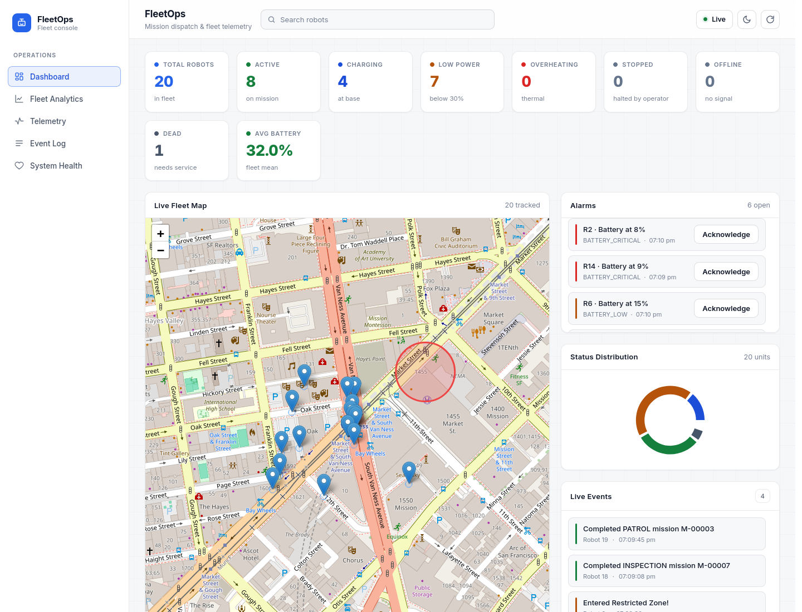

# FleetOps

Real-time robot fleet monitoring and control: telemetry ingestion, live
dashboards over WebSocket, and command dispatch, built on FastAPI and
TimescaleDB.

[Live demo](https://robot-fleet-platform-eight.vercel.app)

## What it does

Robots report telemetry (battery, position, component health, mission
progress). Operators see the fleet live on a map, get each robot's status and
remaining battery runtime, and send commands such as return-to-base or
emergency stop.

## Architecture

~~~text
Robot agent ──MQTT (QoS 1, CBOR, device keys, last will)──► Mosquitto ──► FastAPI ──► TimescaleDB
 on-disk outbox                                                 │  ack after    │     telemetry (hypertable)
  ▲  ▲                                                          │  commit       │     robot_state, commands,
  │  └──── commands, settings, "stored up to N" ◄───────────────┘               │     events, robots, users
  └─ deletes only what the server confirmed                                     ▼
                                                                WebSocket ──► Dashboard (React, Vercel)
~~~

The broker is the queue: the API acknowledges a message only after it is
committed. On the robot, the agent keeps every reading on disk until the API
confirms it is stored, so a crash of the robot, the API or the broker loses
nothing (measured, with the remaining gaps listed in
[the architecture doc](docs/architecture.md#measured-durability)). Every reading
goes through one write path that inserts it, registers the robot and updates
its current state in a single transaction. There is no Redis and no worker
process.

This is a redesign aimed at running a fleet on the smallest possible server.
See
[ADR 0001](docs/adr/0001-mqtt-and-timescale.md) and
[ADR 0002](docs/adr/0002-efficiency-and-error-budgeted-telemetry.md).

## Engineering decisions

- **No data loss, measured.** Messages are acknowledged only after commit, and
  robots keep them on disk until the server confirms they are stored. Chaos
  tests (20 robots, `kill -9` of the robots, the API or the broker mid-stream)
  stored every reading exactly once in every run. The previous client lost
  readings the broker had already acknowledged when the broker was killed.
- **A robot agent package.** [`agent/`](agent/README.md): compact CBOR
  messages (a reading is 20 to 35 bytes in a batch, against about 450 as
  JSON), a SQLite outbox, commands run once, and settings pushed from the
  server with the robot reporting what it applied.
- **Dual prediction.** Robot and server run the same predictor; the robot
  sends only when reality strays past a tolerance, and every value on the API
  carries its error bound. In the simulator that is 55% fewer messages at the
  default tolerances, and the tolerances are the dial.
- **Streaming intelligence.** Battery runtime from a Kalman filter, with its
  range; offline suspicion by phi accrual over each robot's own rhythm;
  anomalies as robust z-scores against fleet peers. Constant memory per
  robot, no history queries.
- **Alarms without storms.** Separate raise and clear thresholds, hold times,
  one open alarm per robot and kind, acknowledge and clear, signed webhooks.
- **A message budget.** An operator sets one number for the fleet; the server
  chooses every robot's tolerance to meet it, tighter where an alarm,
  an anomaly or a watching operator makes accuracy matter, with feedback on
  what the fleet actually sends.
- **Exact rollups.** Minutes and hours are time-weighted integrals of the
  prediction between keyframes, not averages of unevenly spaced rows; minutes
  kept a year, hours indefinitely.
- **A dashboard that moves between messages.** The map runs the same
  predictor, so robots glide although they report rarely, each with its error
  bound drawn.
- **Fast clocks corrected.** A robot whose clock runs ahead has its readings
  moved back by the measured offset, keeping their spacing.
- **Idempotent writes.** A reading is identified by `(robot_id, timestamp)`,
  the table's primary key, so a redelivered message is never stored twice.
- **Presence from the last will.** A robot whose connection drops is shown
  offline within a second, not after a minute of silence.
- **Pushed commands.** Commands go into the robot's persistent session, so one
  sent while the robot is offline is delivered when it reconnects.
- **Current state on write.** `robot_state` holds one row per robot, updated
  only by newer readings, so fleet status never scans history.
- **TimescaleDB.** One-day chunks, compression after a day, and a 30-day
  retention policy that drops whole chunks instead of deleting rows.
- **Per-robot device keys.** Random keys stored only as hashes. They are the
  robots' broker credentials: a robot can only use its own topics and cannot
  take over another robot's session.
- **Compare-and-set command transitions.** Concurrent status updates cannot
  both win a transition.
- **Bounded WebSocket queues.** A slow client drops its oldest frames instead of
  stalling fan-out for everyone else.
- **Short-lived console tickets.** The browser never holds the master API key.
- **Measured, including the misses.** `bench/run.py` runs the whole stack
  inside 480 MB: 24 robots peak at 261 MB, about $0.33 a robot a month on a
  t4g.nano. The simulator sends more than the targets allow, and
  [the benchmark](docs/benchmark.md) says why.

## Testing

Tests cover:

- telemetry ingestion, idempotency and fleet-state derivation
- the MQTT consumer, presence, command push and broker auth, partly against a
  real broker (set `MQTT_TEST_HOST`)
- the stored watermark, robot settings and the agent's wire format
- the agent itself: outbox durability, resends after a broker loses messages,
  a robot process killed with `-9`
- device keys, rotation and revocation
- command concurrency, idempotency and timeouts
- WebSocket lifecycle and reconnect behavior
- authentication and command dispatch
- structured logging

Backend:

~~~bash
cd backend
docker run -d -p 1883:1883 eclipse-mosquitto:2.0.22 mosquitto -c /mosquitto-no-auth.conf
DATABASE_URL=postgresql://postgres:<password>@localhost:5432/fleet_test_db \
  MQTT_TEST_HOST=localhost pytest tests/ -v --cov=app
~~~

Agent:

~~~bash
cd agent
pip install -e '.[test]'
MQTT_TEST_HOST=localhost pytest
~~~

Frontend:

~~~bash
cd frontend/robot-fleet-dashboard
npm ci
npm run test:coverage
~~~

## Run locally

Prerequisites: Docker and Docker Compose.

~~~bash
git clone https://github.com/colin-110/robot-fleet-platform.git
cd robot-fleet-platform
cp backend/.env.example backend/.env
docker compose up --build -d
~~~

The stack starts the API, dashboard, simulator (40 robots over MQTT), TimescaleDB and the Mosquitto broker.

## Repository structure

- `backend/app/` - API routes, services, repositories and authentication
- `backend/tests/` - backend test suite
- `frontend/robot-fleet-dashboard/` - React dashboard
- `agent/` - the robot-side package (`fleetops-agent`)
- `simulator/` - asynchronous robot simulator, each robot sending through its own agent
- `mosquitto/` - broker configuration
- `docs/` - architecture, operations, and design decisions (`docs/adr/`)
- `docker-compose.yml` - the full stack; `docker-compose.override.yml` - development settings, loaded automatically

## Limitations

This is a portfolio-scale system using synthetic robot data, single-node and without high availability. The live demo still runs the previous version.

## License

MIT
