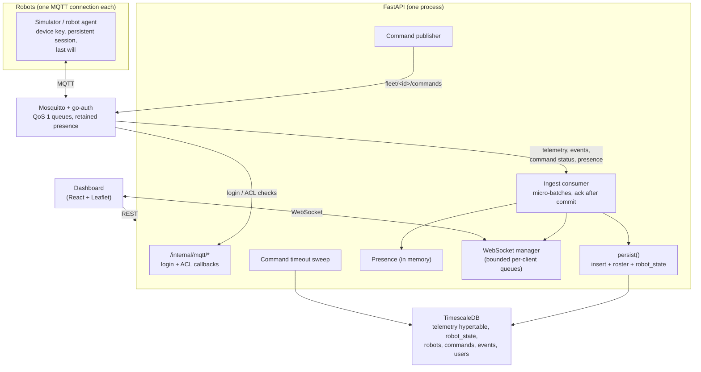

# Architecture

[← Back to README](../README.md)

Robots talk to an MQTT broker; the API consumes from it, writes every reading
through one function into TimescaleDB, and pushes commands back through the
broker. Dashboards get updates over WebSocket. The design is in
[ADR 0001](adr/0001-mqtt-and-timescale.md) and
[ADR 0002](adr/0002-efficiency-and-error-budgeted-telemetry.md).

## Topics

| Topic | Direction | Notes |
| :--- | :--- | :--- |
| `fleet/<id>/telemetry` | robot to server | One reading or a JSON array of them, QoS 1 |
| `fleet/<id>/events` | robot to server | Must carry the device timestamp |
| `fleet/<id>/commands/status` | robot to server | `{"id", "status", ...}`, same state machine as the HTTP `PATCH` |
| `fleet/<id>/presence` | robot to server | Retained `online`; the last will is a retained `offline` |
| `fleet/<id>/commands` | server to robot | Pushed with QoS 1 into the robot's persistent session |
| `fleetops/live` | server to server | Dashboard updates relayed between API processes (`WEBSOCKET_BACKEND=mqtt`) |

A robot may only publish its own uplink topics and subscribe to its own
commands. The broker replaces every client id with the username, so a robot
cannot connect as another robot's client id and take over its session.

## Message flow

1. A robot publishes readings with QoS 1. The broker queues them in the API's
   persistent session.
2. The consumer collects up to 200 messages or 250 ms, then `persist()` inserts
   the readings (skipping any already stored), registers the robot and upserts
   its `robot_state`, all in one transaction.
3. Only after the commit are the messages acknowledged. If the API dies first,
   the broker delivers them again and the duplicate insert is skipped.
4. Only newly stored readings are broadcast to dashboards.
5. When a robot's connection drops, the broker publishes its last will and the
   robot is shown offline within a second.
6. A new command is published to the robot. The broker's acknowledgement moves
   it to `DISPATCHED`; if the robot has never subscribed, the command waits as
   `PENDING` and is pushed again when the robot comes online.

The HTTP endpoints (`POST /telemetry`, `/events`, command claim and status)
remain as a thin adapter onto the same functions, for simple clients and tests.

## Measured durability

A chaos test runs 20 robots at 10 readings per second each and `kill -9`s the
API or the broker mid-stream. In five runs, every reading was stored exactly
once (for example 7,640 sent, 7,640 stored, 7,640 distinct). The first run
against the broker lost 18%: Mosquitto does not restore shared subscriptions
after a restart, so ingest now uses plain persistent subscriptions.

What is not covered yet: if the robot itself crashes, readings in its MQTT
client's memory are lost (the on-disk outbox in ADR 0002, step 3, fixes this),
and a crash of the whole host can lose what the broker accepted in its last
autosave interval (5 seconds) before delivering it.

---

## Engineering highlights

**One write path.** Every reading is written by the same function in one
transaction, so the telemetry, the roster and the current state can never
disagree.

**Real-time fan-out that survives slow clients.** Every connection has a bounded outbound queue drained by a single dedicated sender task. Broadcasting is a non-blocking put onto every client's queue, so it never awaits a slow socket and never spawns a task per message. When a client cannot keep up, the *oldest* buffered frame is dropped rather than the newest, because stale telemetry is worthless - a robot's position from three seconds ago is noise. This caps memory per connection and prevents one stalled client from back-pressuring the entire fleet.

**A roster, so absence is detectable.** Fleet status is the robot roster LEFT JOINed onto each robot's latest state, not a `GROUP BY` over recent telemetry. The distinction is the difference between a working monitor and a broken one: deriving the fleet from telemetry alone means a robot that stops reporting eventually falls outside the query window and silently disappears from the dashboard, so a unit that died an hour ago is indistinguishable from one that never existed. Registered robots are always listed, and missing telemetry renders `OFFLINE` with the roster's last-seen time. The roster populates itself: every write registers the robot in the same transaction.

**Device-reported timestamps.** A reading carries when the *device* measured it, not when the server received it. This is what makes store-and-forward possible: a robot that buffers readings through a network outage can upload them with their real times instead of collapsing an entire outage onto one instant. Future-dated readings beyond a configurable skew are clamped, since a device with a fast clock would otherwise sit permanently at the head of "most recent" and make a dead robot look alive.

**Idempotent writes.** A reading is identified by its robot and device timestamp, so the timestamp is required and `(robot_id, timestamp)` is the primary key. Events are unique by robot, time and message. Inserts use `ON CONFLICT DO NOTHING`, so a redelivered message cannot create duplicate rows, and only newly stored rows are broadcast.

**Acknowledged only after commit.** The broker is the queue: QoS 1 on persistent sessions, and the consumer acknowledges a message only once its batch is committed. A failed write is retried without acknowledging, so the broker keeps queueing; a malformed message is acknowledged and dropped so it is not redelivered forever. Acks for a connection that has since been replaced are skipped, because a packet id only means something on the connection that delivered it. The dashboard ignores a reading older than what it already shows, so a late redelivery does not move a robot backwards.

**Presence from the last will.** Each robot registers a retained `offline` will and publishes a retained `online` on connect, so a fresh subscription receives every robot's presence with no query. Both carry a connection id: when a robot reconnects before the broker notices its old connection died, the old will can arrive after the new `online`, and is ignored. Presence and readings are applied in arrival order, since a robot's last reading and its will often share a batch.

**Pushed commands with compare-and-set transitions.** Commands move through an explicit state machine (`PENDING` to `DISPATCHED` to `ACKNOWLEDGED` to `EXECUTING` to `COMPLETED`). Dispatching a command and advancing its status are each a single conditional `UPDATE ... WHERE status = :expected`, so when two writers race, exactly one matches a row and the loser receives a `409`. A command is dispatched when the broker acknowledges it into the robot's session; a robot may acknowledge straight from `PENDING`, since the push can reach it before the server processes that acknowledgement. Doing the validation in application code and writing afterwards would allow both writers to observe the same state and both commit. Expired commands are swept to `TIMEOUT` by the API, with a Postgres advisory lock so several processes do not scan at once.

---

## Repository structure

| Path | Description |
| :--- | :--- |
| [`backend/`](../backend) | FastAPI application (routes, services, repositories), SQLAlchemy async models and Alembic migrations. |
| [`backend/tests/`](../backend/tests) | Pytest suite running against real TimescaleDB. |
| [`frontend/robot-fleet-dashboard/`](../frontend/robot-fleet-dashboard) | React 19 and Vite dashboard (Leaflet map, Recharts, WebSocket hooks), served by nginx. |
| [`simulator/`](../simulator) | Async Python simulator with physics-based robot agents, one MQTT connection per robot. |
| [`mosquitto/`](../mosquitto) | Broker configuration (go-auth against the API, persistence, queues). |
| [`scripts/`](../scripts) | EC2 provisioning and the CI deploy role. |
| [`docs/`](.) | Architecture, operations, and design decisions ([`adr/`](adr)). |
| [`.github/workflows/`](../.github/workflows) | CI/CD pipeline. |
