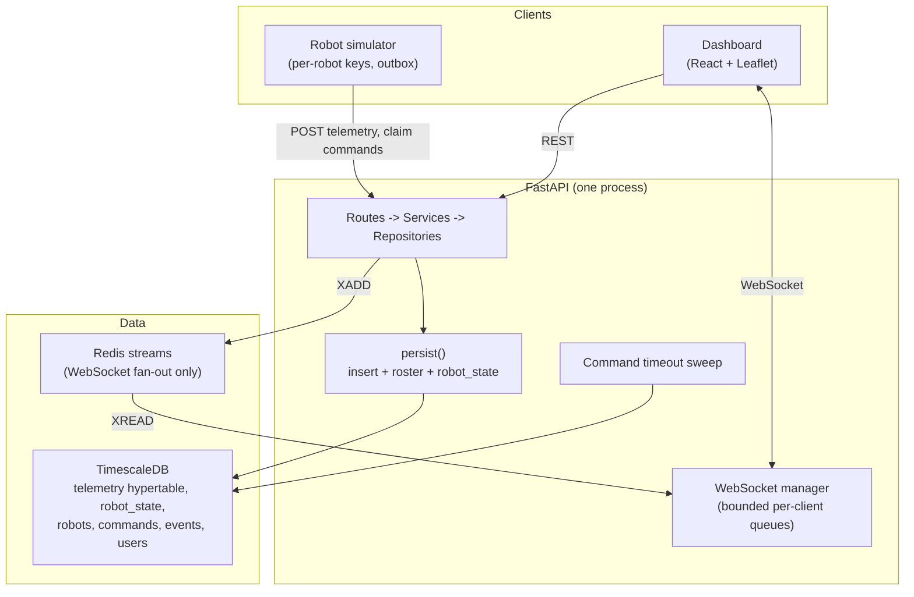

# Architecture

[← Back to README](../README.md)

Robots send telemetry over HTTP. Every reading goes through one write path into
TimescaleDB, and dashboards get updates over WebSocket. The planned move to
MQTT is described in [ADR 0001](adr/0001-mqtt-and-timescale.md) and
[ADR 0002](adr/0002-efficiency-and-error-budgeted-telemetry.md).

## Request flow

1. A robot `POST`s a batch of readings with its device key. The key must belong
   to the robot each reading is for.
2. `persist()` inserts the readings (skipping any already stored), registers the
   robot and upserts its `robot_state`, all in one transaction.
3. Only newly stored readings are published for WebSocket fan-out.
4. The dashboard reads fleet status from `robot_state`: one row per robot,
   whatever the size of the history.

---

## Engineering highlights

**One write path.** Every reading is written by the same function in one
transaction, so the telemetry, the roster and the current state can never
disagree.

**Real-time fan-out that survives slow clients.** Every connection has a bounded outbound queue drained by a single dedicated sender task. Broadcasting is a non-blocking put onto every client's queue, so it never awaits a slow socket and never spawns a task per message. When a client cannot keep up, the *oldest* buffered frame is dropped rather than the newest, because stale telemetry is worthless - a robot's position from three seconds ago is noise. This caps memory per connection and prevents one stalled client from back-pressuring the entire fleet.

**A roster, so absence is detectable.** Fleet status is the robot roster LEFT JOINed onto each robot's latest state, not a `GROUP BY` over recent telemetry. The distinction is the difference between a working monitor and a broken one: deriving the fleet from telemetry alone means a robot that stops reporting eventually falls outside the query window and silently disappears from the dashboard, so a unit that died an hour ago is indistinguishable from one that never existed. Registered robots are always listed, and missing telemetry renders `OFFLINE` with the roster's last-seen time. The roster populates itself: every write registers the robot in the same transaction.

**Device-reported timestamps.** A reading carries when the *device* measured it, not when the server received it. This is what makes store-and-forward possible: a robot that buffers readings through a network outage can upload them with their real times instead of collapsing an entire outage onto one instant. Future-dated readings beyond a configurable skew are clamped, since a device with a fast clock would otherwise sit permanently at the head of "most recent" and make a dead robot look alive.

**Idempotent writes.** A reading is identified by its robot and device timestamp, so the timestamp is required and `(robot_id, timestamp)` is the primary key. Inserts use `ON CONFLICT DO NOTHING`, so a retried upload cannot create duplicate rows, and only newly stored readings are broadcast.

**Retries are safe.** A successful response means the readings are committed. The simulator keeps each reading in an outbox until a POST containing it succeeds and retries failed uploads with backoff; because writes are idempotent, a retry never creates duplicates. The dashboard ignores a reading older than what it already shows, so a late retry does not move a robot backwards.

**Idempotent command dispatch with compare-and-set transitions.** Commands move through an explicit state machine (`PENDING` to `DISPATCHED` to `ACKNOWLEDGED` to `EXECUTING` to `COMPLETED`). Both claiming a command and advancing its status are performed as a single conditional `UPDATE ... WHERE status = :expected`, so when two pollers or two status updates race, exactly one matches a row and the loser receives a `409`. Doing the validation in application code and writing afterwards would allow both writers to observe the same state and both commit. Expired commands are swept to `TIMEOUT` by the API, with a Postgres advisory lock so several processes do not scan at once.

---

## Repository structure

| Path | Description |
| :--- | :--- |
| [`backend/`](../backend) | FastAPI application (routes, services, repositories), SQLAlchemy async models and Alembic migrations. |
| [`backend/tests/`](../backend/tests) | Pytest suite running against real TimescaleDB. |
| [`frontend/robot-fleet-dashboard/`](../frontend/robot-fleet-dashboard) | React 19 and Vite dashboard (Leaflet map, Recharts, WebSocket hooks), served by nginx. |
| [`simulator/`](../simulator) | Async Python simulator with physics-based robot agents. |
| [`scripts/`](../scripts) | EC2 provisioning and the CI deploy role. |
| [`docs/`](.) | Architecture, operations, and design decisions ([`adr/`](adr)). |
| [`.github/workflows/`](../.github/workflows) | CI/CD pipeline. |
