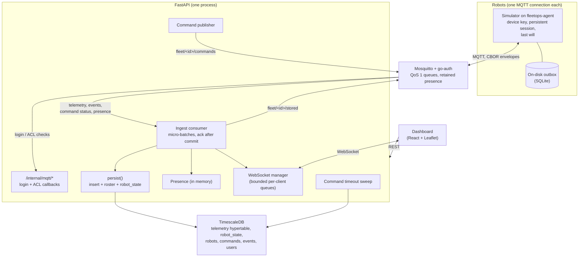

# Architecture

[← Back to README](../README.md)

Robots talk to an MQTT broker; the API consumes from it, writes every reading
through one function into TimescaleDB, and pushes commands back through the
broker. Dashboards get updates over WebSocket. The design is in
[ADR 0001](adr/0001-mqtt-and-timescale.md) and
[ADR 0002](adr/0002-efficiency-and-error-budgeted-telemetry.md).

## Topics

| Topic | Direction | Notes |
| :--- | :--- | :--- |
| `fleet/<id>/telemetry` | robot to server | A CBOR envelope from the agent, or plain JSON (one reading or an array), QoS 1 |
| `fleet/<id>/events` | robot to server | Must carry the device timestamp |
| `fleet/<id>/commands/status` | robot to server | `{"id", "status", ...}`, same state machine as the HTTP `PATCH` |
| `fleet/<id>/presence` | robot to server | Retained `online`; the last will is a retained `offline` |
| `fleet/<id>/config/reported` | robot to server | Retained: the settings the robot applied, and any it refused |
| `fleet/<id>/commands` | server to robot | Pushed with QoS 1 into the robot's persistent session |
| `fleet/<id>/config` | server to robot | Retained desired settings, `{"version", "values"}` |
| `fleet/<id>/stored` | server to robot | Retained: everything up to this sequence number of the robot's outbox is committed |
| `fleetops/live` | server to server | Dashboard updates relayed between API processes (`WEBSOCKET_BACKEND=mqtt`) |

The agent's messages are CBOR envelopes with the MQTT 5 content type
`application/vnd.fleetops.v1+cbor`: a stream id, the sequence number of the
first item, the robot's floor (the lowest number it still holds), its send
time, and the items with short keys, fixed-point numbers and only the fields
that changed. A reading is about 130 bytes on its own and 20 to 35 inside a
batch, against about 450 as JSON. The format is defined once, in
[`agent/fleetops_agent/wire.py`](../agent/fleetops_agent/wire.py); the API
keeps an identical copy and a test fails if they differ.

A robot may only publish its own uplink topics and subscribe to its own
downlink topics. The broker replaces every client id with the username, so a robot
cannot connect as another robot's client id and take over its session.

## Message flow

1. The agent writes each reading to its on-disk outbox, then publishes batches
   of them with QoS 1. The broker queues them in the API's persistent session.
2. The consumer collects up to 200 messages or 250 ms, then `persist()` inserts
   the readings (skipping any already stored), registers the robot and upserts
   its `robot_state`, all in one transaction.
3. The consumer moves each robot's watermark (how far its outbox stream is
   committed, contiguously), saves it, and publishes it to the robot's retained
   `stored` topic. Only then are the messages acknowledged. If the API dies
   first, the broker delivers them again and the duplicate insert is skipped.
4. The agent deletes confirmed items from its outbox. Anything not confirmed
   within 15 seconds is sent again, so a message the broker accepted and then
   lost leaves a gap the watermark will not pass until it is filled.
5. Only newly stored readings are broadcast to dashboards.
6. When a robot's connection drops, the broker publishes its last will and the
   robot is shown offline within a second.
7. A new command is published to the robot. The broker's acknowledgement moves
   it to `DISPATCHED`; if the robot has never subscribed, the command waits as
   `PENDING` and is pushed again when the robot comes online. The agent
   remembers command ids on disk and runs each command once.
8. An operator's `PUT /api/v1/robots/<id>/config` is stored with a new version
   and published to the robot's retained `config` topic; the agent applies it
   and reports the version back, so the API can say whether the robot is in
   sync.

The HTTP endpoints (`POST /telemetry`, `/events`, command claim and status)
remain as a thin adapter onto the same functions, for simple clients and tests.

## Measured durability

Chaos tests run 20 robots at 10 readings per second each and `kill -9` one
component mid-stream, then count what reached the database.

| Crash | Result |
| :--- | :--- |
| The API, or the broker while the API consumes | Every reading stored exactly once, five runs (for example 7,640 sent, 7,640 stored) |
| The robots, while they cannot reach the broker | Every reading stored exactly once, three runs (1,698 readings were waiting on disk in one run) |
| The broker, holding messages it accepted but had not saved, while the API is down | Agent: every reading stored exactly once, three runs (2,940 of 2,940, after 40 resends). The step 2 client lost 40 of 2,920 and 39 of 2,900, although the broker had acknowledged all of them |

The first broker run in step 2 lost 18%: Mosquitto does not restore shared
subscriptions after a restart, so ingest uses plain persistent subscriptions.
The step 3 runs found two bugs that would each have stopped ingest for the
whole fleet: the command publisher raised on the broker's acknowledgement of a
watermark, which killed paho's network thread, and a batch of large envelopes
went over Postgres's limit of 32,767 parameters per statement, which failed on
every retry. A value too long for its column would have failed the same way;
it is now refused per item before it reaches the database.

What is not covered: a robot whose outbox fills (100,000 items by default)
drops its oldest items, which the server counts and logs; and losing power on
the robot can undo its last few outbox writes unless the outbox runs with
`synchronous="FULL"`.

---

## Engineering highlights

**One write path.** Every reading is written by the same function in one
transaction, so the telemetry, the roster and the current state can never
disagree.

**Real-time fan-out that survives slow clients.** Every connection has a bounded outbound queue drained by a single dedicated sender task. Broadcasting is a non-blocking put onto every client's queue, so it never awaits a slow socket and never spawns a task per message. When a client cannot keep up, the *oldest* buffered frame is dropped rather than the newest, because stale telemetry is worthless - a robot's position from three seconds ago is noise. This caps memory per connection and prevents one stalled client from back-pressuring the entire fleet.

**A roster, so absence is detectable.** Fleet status is the robot roster LEFT JOINed onto each robot's latest state, not a `GROUP BY` over recent telemetry. The distinction is the difference between a working monitor and a broken one: deriving the fleet from telemetry alone means a robot that stops reporting eventually falls outside the query window and silently disappears from the dashboard, so a unit that died an hour ago is indistinguishable from one that never existed. Registered robots are always listed, and missing telemetry renders `OFFLINE` with the roster's last-seen time. The roster populates itself: every write registers the robot in the same transaction.

**Device-reported timestamps.** A reading carries when the *device* measured it, not when the server received it. This is what makes store-and-forward possible: a robot that buffers readings through a network outage can upload them with their real times instead of collapsing an entire outage onto one instant. A fast clock is corrected: the agent's envelope says when it was sent by the robot's clock, and a message cannot have been sent after it arrived, so every time in it moves back by the difference and readings keep their spacing. Plain JSON readings dated beyond a configurable skew are clamped to the receive time instead, since a device with a fast clock would otherwise sit permanently at the head of "most recent" and make a dead robot look alive.

**Confirmed end to end.** A broker acknowledgement only means the broker has the message. The agent keeps every item in a SQLite outbox until the API says it is committed (`fleet/<id>/stored`), and the API's watermark only moves contiguously, so a message lost anywhere after the robot leaves a gap that is resent rather than skipped. The watermark is saved in the database after the batch it covers, so it survives an API restart.

**Idempotent writes.** A reading is identified by its robot and device timestamp, so the timestamp is required and `(robot_id, timestamp)` is the primary key. Events are unique by robot, time and message. Inserts use `ON CONFLICT DO NOTHING`, so a redelivered message cannot create duplicate rows, and only newly stored rows are broadcast.

**Acknowledged only after commit.** The broker is the queue: QoS 1 on persistent sessions, and the consumer acknowledges a message only once its batch is committed. A failed write is retried without acknowledging, so the broker keeps queueing; a malformed message is acknowledged and dropped so it is not redelivered forever. Acks for a connection that has since been replaced are skipped, because a packet id only means something on the connection that delivered it. The dashboard ignores a reading older than what it already shows, so a late redelivery does not move a robot backwards.

**Presence from the last will.** Each robot registers a retained `offline` will and publishes a retained `online` on connect, so a fresh subscription receives every robot's presence with no query. Both carry a connection id: when a robot reconnects before the broker notices its old connection died, the old will can arrive after the new `online`, and is ignored. Presence and readings are applied in arrival order, since a robot's last reading and its will often share a batch.

**Pushed commands with compare-and-set transitions.** Commands move through an explicit state machine (`PENDING` to `DISPATCHED` to `ACKNOWLEDGED` to `EXECUTING` to `COMPLETED`). Dispatching a command and advancing its status are each a single conditional `UPDATE ... WHERE status = :expected`, so when two writers race, exactly one matches a row and the loser receives a `409`. A command is dispatched when the broker acknowledges it into the robot's session; a robot may acknowledge straight from `PENDING`, since the push can reach it before the server processes that acknowledgement. Doing the validation in application code and writing afterwards would allow both writers to observe the same state and both commit. Expired commands are swept to `TIMEOUT` by the API, with a Postgres advisory lock so several processes do not scan at once.

---

## Repository structure

| Path | Description |
| :--- | :--- |
| [`backend/`](../backend) | FastAPI application (routes, services, repositories), SQLAlchemy async models and Alembic migrations. |
| [`backend/tests/`](../backend/tests) | Pytest suite running against real TimescaleDB. |
| [`frontend/robot-fleet-dashboard/`](../frontend/robot-fleet-dashboard) | React 19 and Vite dashboard (Leaflet map, Recharts, WebSocket hooks), served by nginx. |
| [`agent/`](../agent) | `fleetops-agent`, the robot-side package: wire format, on-disk outbox, MQTT client, settings. |
| [`simulator/`](../simulator) | Async Python simulator with physics-based robots, each sending through its own agent. |
| [`mosquitto/`](../mosquitto) | Broker configuration (go-auth against the API, persistence, queues). |
| [`scripts/`](../scripts) | EC2 provisioning and the CI deploy role. |
| [`docs/`](.) | Architecture, operations, and design decisions ([`adr/`](adr)). |
| [`.github/workflows/`](../.github/workflows) | CI/CD pipeline. |
